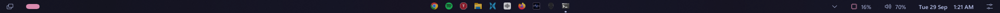
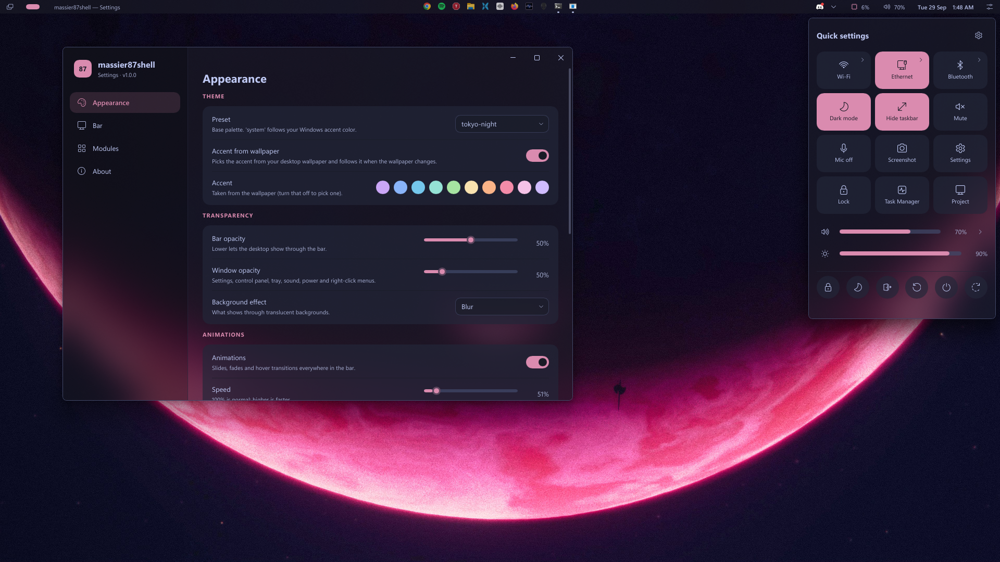

# massier87shell


A customizable, lightweight top bar for **Windows 11**, inspired by
[Noctalia Shell](https://github.com/noctalia-dev/noctalia-shell) and
[DankMaterialShell](https://github.com/AvengeMedia/DankMaterialShell).
Written in Rust with the [Slint](https://slint.dev) UI toolkit.





It replaces the Windows taskbar with a slim bar made of modules: apps, workspaces, clock,
media, system stats, tray and a quick-settings panel. Everything is themeable and editable
from a built-in settings window, and it idles at about 30 MB of RAM.

## Features

- **Taskbar apps:** pinned and running apps with crisp icons. Hover for live window
  previews, right-click for a menu (open, pin/unpin, close), drag to reorder.
- **Quick settings panel:**
  - Toggles: Wi-Fi, Ethernet, Bluetooth, airplane mode, dark mode, mute, mic.
  - Sliders: volume and brightness.
  - A media card, and power buttons that ask before restarting or shutting down.
- **Wi-Fi and Ethernet pages:** network list, connect with a password, disconnect, network
  properties; adapter status, speed and IP address.
- **Sound panel:** switch output and input devices, set master and mic volume, and a per-app
  mixer with volume and mute for each app.
- **Background apps (tray):** every tray icon in one panel. Pin the ones you want on the bar.
- **Hide the Windows taskbar** completely and reclaim its space, with a shortcut
  (Ctrl+Win+B) and a quick-settings tile.
- **Drag to move windows:** drag empty bar space to pull the maximized window below out of
  maximized, like grabbing its title bar. Drop it back on the bar to maximize it again.
- **Themes:**
  - Presets: Catppuccin, Tokyo Night, Gruvbox, Nord, Rosé Pine, Material, or your Windows
    accent. Any single color can be overridden.
  - The accent can follow your wallpaper.
- **Transparency:** see-through bar and windows, with a clear, blur or acrylic effect behind
  them.
- **Settings window:**
  - Drag-and-drop module layout and per-module options.
  - Animation speed.
  - Floating or docked bar, corners, fonts, sizes.
  - Changes apply instantly and are saved automatically.
- **Multi-monitor:** one bar on the primary display, or one per display.
- **Starts with Windows** right as you sign in.

## Requirements

- Windows 11. Windows 10 is untested: much of the look relies on Windows 11 features
  (rounded corners, acrylic).
- Building needs [Rust](https://rustup.rs) (stable, edition 2024) and the
  [MSVC C++ Build Tools](https://visualstudio.microsoft.com/visual-cpp-build-tools/).

## Build and run

```sh
git clone <repository-url>
cd massier87shell
cargo build --release
target\release\massier87shell.exe
```

Or build and start in one step with `cargo run --release`. On first run, the bar creates its
config file with the defaults: a slim, translucent bar across the top of every display, with
the accent taken from your wallpaper. It also **hides the Windows taskbar**; press Ctrl+Win+B,
or turn it off in Settings → Bar, to get it back.

To start it automatically, turn on **Settings → Bar → Start with Windows**. This registers a
per-user Task Scheduler task (no admin rights needed) that starts the bar as soon as you sign
in.

Only one copy runs at a time. To quit, use **Quit bar** in the power menu. The Windows taskbar
comes back whenever the bar isn't running.

### Command-line options

| Option | Effect |
|--------|--------|
| `--settings` | Open the settings window at startup |
| `--control` | Open the quick-settings panel at startup |
| `--config <path>` | Use a different config file |
| `--version` | Print the version |

## Usage

Open **Settings** from the gear in the quick-settings panel (the sliders icon at the right end
of the bar). The `settings` module and a right-click on the `launcher` module open it too.

- **Modules page:** drag modules between the left, center and right sections. The gear on a
  module opens its options.

### Modules

| Module | Shows | Left click | Right click | Scroll |
|--------|-------|------------|-------------|--------|
| `launcher` | Start button | Start menu | Settings | |
| `workspaces` | Virtual desktops | Switch desktop | | Previous / next desktop |
| `taskview` | Task View button | Task View (or on hover) | | |
| `taskbar` | Pinned and running apps | Open / focus / minimize (middle click: new window) | App menu | |
| `window` | Focused window title | Drag to move the window | | |
| `clock` | Date and time | Calendar and notifications | | |
| `media` | Now playing, with prev / play-pause / next | Buttons control playback | | |
| `cpu`, `ram` | Usage in % | Task Manager | | |
| `temp` | NVIDIA GPU temperature | Task Manager | | |
| `tray` | Pinned tray icons, plus a button for all of them | Background apps panel | | |
| `control` | Quick settings button | Quick-settings panel | | |
| `volume` | Volume in % | Sound panel (devices and mixer) | Windows quick settings | Volume up / down |
| `battery` | Battery level | | | |
| `settings` | Gear button | Settings window | | |
| `power` | Power button | Power menu | Win+X menu | |

## Configuration

The config file is `%APPDATA%\massier87shell\config.toml`:
- The settings window edits it and keeps any comments you've added.
- You can also edit it by hand: it's reloaded within a second of saving.
- [`config.default.toml`](config.default.toml) documents every option.

| Section | What it controls |
|---------|------------------|
| `[bar]` | Position, height, floating and margin, corners, border, font, spacing, displays, renderer, drag-to-move, hiding the Windows taskbar and its shortcut |
| `[theme]` | Preset, color overrides, accent from wallpaper, bar and window opacity, blur |
| `[modules]` | Which modules sit on the left, center and right |
| `[clock]` | Format ([chrono strftime](https://docs.rs/chrono/latest/chrono/format/strftime/)) |
| `[taskbar]` | Icon size, monochrome icons, pinned apps |
| `[tray]` | Tray apps pinned to the bar |
| `[control]` | Quick-settings tiles and sections |
| `[volume]` | Scroll step |
| `[stats]` | Refresh interval for CPU, RAM, temperature and battery |
| `[temp]` | Celsius or Fahrenheit |
| `[taskview]` | Open on click or hover, hover delay |
| `[animations]` | On/off, speed, hover effects |
| `[window]`, `[media]` | Maximum title widths |

A small example:

```toml
[bar]
floating = true
height = 40
hide_windows_taskbar = true

[theme]
preset = "tokyo-night"
accent_from_wallpaper = true
opacity = 0.6
blur = "acrylic"

[modules]
left   = ["launcher", "workspaces", "taskbar"]
center = ["clock"]
right  = ["media", "tray", "cpu", "ram", "control", "volume", "power"]
```

## Performance

The bar uses Slint's software renderer by default: for a thin bar, redrawing only the pixels
that changed is cheaper than the GPU renderers, which redraw the whole window every frame. You
can switch with `[bar] renderer` (needs a restart).

Slow work runs on background threads so the bar never stutters: Wi-Fi scans, brightness,
media, wallpaper decoding and GPU temperature. System stats update at the interval you choose.

## Known limitations

- **Wi-Fi network list:** Windows 11 (24H2 and later) only lets apps list Wi-Fi networks when
  **Location** is on for desktop apps. Without it, the panel explains this and links to the
  setting and to Windows' own network list.
- **Temperature:** only NVIDIA GPUs (through NVML). Windows doesn't expose CPU temperatures
  to normal apps.
- **Brightness:** built-in laptop displays only. External monitors aren't supported.
- **Undocumented APIs:** a few features use Windows interfaces that Microsoft doesn't
  document, and a future Windows update could break them. They are switching the default
  audio device (`IPolicyConfig`) and the blur/acrylic effect (`SetWindowCompositionAttribute`).
- **Tray:** while the `tray` module is on, the bar receives the tray icons of every app and
  forwards them to Explorer, so the Windows tray keeps working as usual.

## Project layout

```
src/
  main.rs       app state, timers, bar windows, popups
  config.rs     config file: loading, defaults, saving (keeps comments)
  settings.rs   settings window <-> config
  appbar.rs     reserving screen space, window placement
  taskbar.rs    taskbar-apps module, drag to move windows
  tray.rs       tray icon host
  winbar.rs     hiding the Windows taskbar
  panel.rs      quick-settings panel
  control.rs    radios, Wi-Fi, Ethernet, brightness (background thread)
  audio.rs      volume, audio devices, per-app volume
  backdrop.rs   blur / acrylic
  wallpaper.rs  accent color from the wallpaper
  ...
ui/             Slint UI: bar, settings, quick settings, menus, previews
```

See [CLAUDE.md](CLAUDE.md) for architecture notes and development tips.

## Acknowledgements

- [Noctalia Shell](https://github.com/noctalia-dev/noctalia-shell) and
  [DankMaterialShell](https://github.com/AvengeMedia/DankMaterialShell) for the inspiration.
- [Slint](https://slint.dev) for the UI toolkit.
- [windows-rs](https://github.com/microsoft/windows-rs) for the Windows API bindings.
- [Catppuccin](https://catppuccin.com), [Tokyo Night](https://github.com/folke/tokyonight.nvim),
  [Gruvbox](https://github.com/morhetz/gruvbox), [Nord](https://www.nordtheme.com) and
  [Rosé Pine](https://rosepinetheme.com) for the color palettes.

## License

[MIT](LICENSE)
